# DataPulse

[](https://github.com/JuanSGarciaC/datapulse/actions/workflows/ci.yml)


**Plataforma de ingeniería de datos de punta a punta:** convierte archivos (CSV, JSON) y una API
REST paginada en información **confiable, trazable e idempotente** para análisis de negocio.
Ingesta validada con cuarentena, orquestación con Prefect, modelo estrella con dbt, API de
indicadores y dashboard, todo levantable con un solo comando.

**Se puede tocar, no solo leer:** prueba un archivo contra los contratos, mira lo que quedó en
cuarentena, sigue un pedido desde el indicador hasta su archivo y rompe la fuente para ver al
pipeline recuperarse. Detalle en [Qué puedes probar](#qué-puedes-probar).

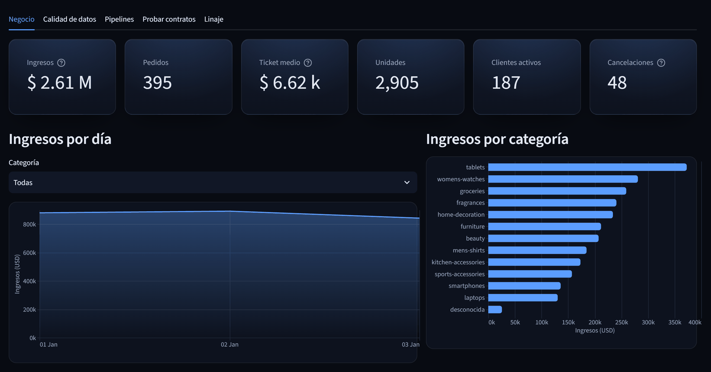

**Todo lo que se describe aquí está implementado y se verifica en CI en cada push**, incluida una
prueba de extremo a extremo contra el stack levantado en contenedores. Lo que no se pudo
verificar está en [Limitaciones conocidas](#limitaciones-conocidas).

## Contenido

[Qué puedes probar](#qué-puedes-probar) · [La landing](#la-landing) ·
[Capturas](#capturas) · [Arquitectura](#arquitectura) · [Stack](#stack-tecnológico) ·
[En números](#en-números) · [Qué demuestra](#qué-demuestra) · [Inicio rápido](#inicio-rápido) ·
[Desarrollo local](#desarrollo-local-windows-powershell) · [Pruebas](#pruebas) ·
[Decisiones técnicas](#decisiones-técnicas) · [Documentación](#documentación) ·
[Seguridad](#seguridad) · [Limitaciones](#limitaciones-conocidas)

## Qué puedes probar

Con la demo en marcha (`.\scripts\demo.ps1`), estas son las funciones que se tocan, no solo
se leen. Todas usan los datos sintéticos de `data/samples`: nada personal ni real.

**Guion de 60 segundos**

1. **0–10 s · Mapa del pipeline:** tres fuentes, validación, raw, dbt y marts, cada una con su
   último estado y si está al día.
2. **10–25 s · Probar contratos:** «Cargar ejemplo con defectos» → tres filas a cuarentena,
   cada una con su campo y su motivo (C00009: email sin @). No se guarda nada.
3. **25–35 s · Bandeja de cuarentena:** lo que esas mismas reglas apartaron de verdad,
   filtrado por el campo `email`.
4. **35–55 s · Linaje de O000065:** el pedido llegó dos veces; se ve la versión superada, la
   vigente, el sha256 de su lote, el archivo y la ejecución que lo cargó.
5. **55–60 s:** cada número del panel se puede seguir hasta su archivo.

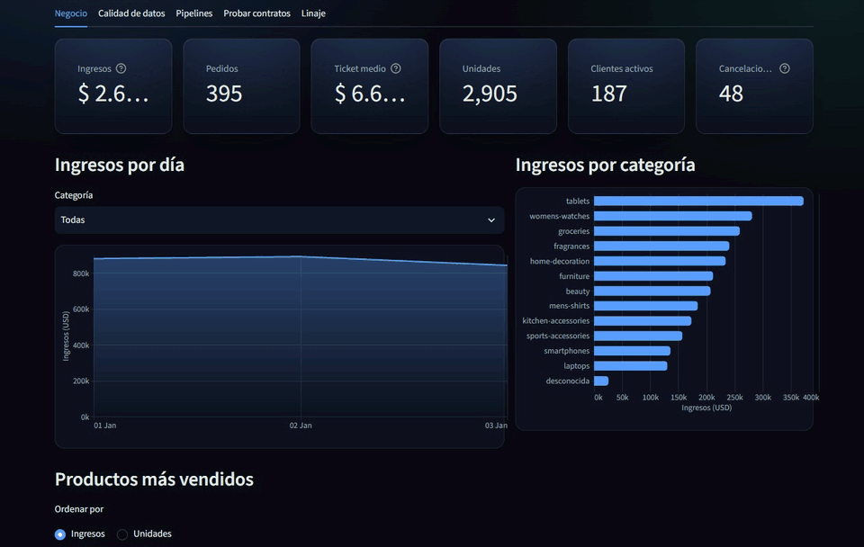

| Función | Qué ves | Dónde |
|---------|---------|-------|
| **Validador en vivo** | Subes un CSV o JSON (o el ejemplo) y ves qué filas irían a cuarentena y por qué, con las mismas reglas que la ingesta | Panel → *Probar contratos* · `POST /v1/contracts/{fuente}/validate` |
| **Bandeja de cuarentena** | Cada fila apartada con su motivo, el valor que falló, el archivo y el lote; el email llega enmascarado | Panel → *Calidad de datos* · `GET /v1/quality/quarantine` |
| **Linaje** | De las líneas del hecho a cada versión recibida, su lote (sha256), archivo y ejecución | Panel → *Linaje* · `GET /v1/lineage/orders/{id}` |
| **Caos en un clic** | La fuente devuelve seis 503 seguidos; el cliente reintenta, Prefect reintenta la tarea y la segunda vez entra | Mapa → *Provocar fallos y ejecutar productos* |
| **Frescura** | Cada fuente dice si está al día frente a su SLA (26 h) | Mapa · `GET /v1/quality/freshness` |
| **Tendencia de calidad** | Porcentaje de filas apartadas por ejecución, con la línea del presupuesto de errores | Panel → *Calidad de datos* |
| **API lista para probar** | Swagger abre con una guía de un minuto; `demo.ps1` imprime la clave de lectura | `/docs` |
| **Landing en vivo** | La página dice si la demo está en marcha en tu equipo y enlaza a cada función | `site/` → *Pruébalo* |

| Validador en vivo | Bandeja de cuarentena |
|:---:|:---:|
| 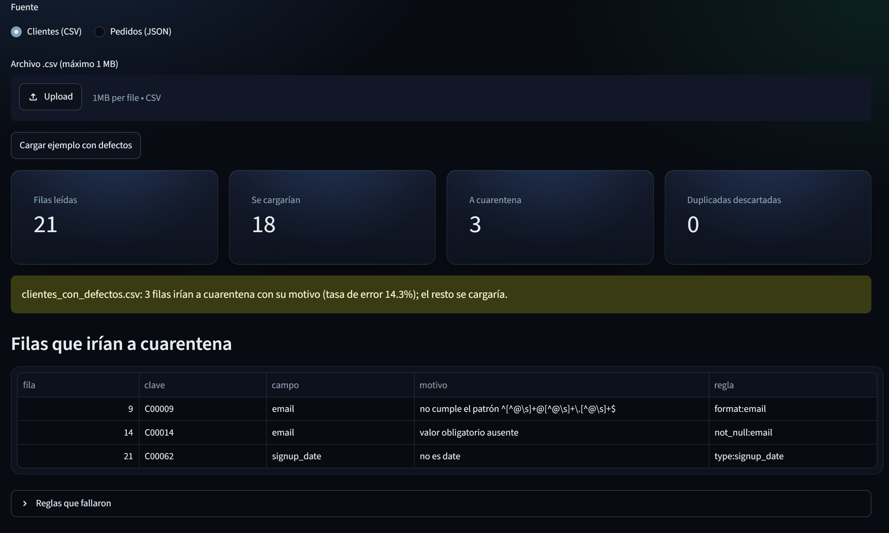 | 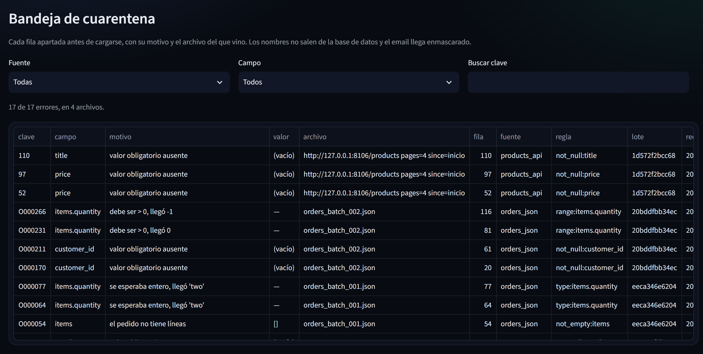 |
| El ejemplo con filas reales defectuosas: tres a cuarentena, cada una con su motivo | Lo que los contratos apartaron de verdad, filtrable por fuente, campo y clave |

| Linaje de O000065 | Caos en un clic |
|:---:|:---:|
| 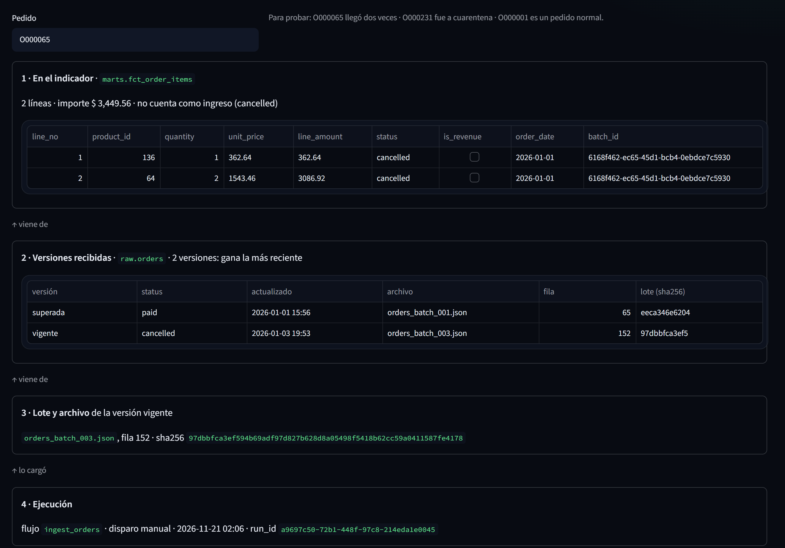 | 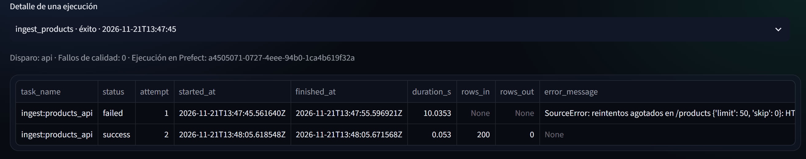 |
| Versión superada y vigente, sha256 completo del lote, archivo, fila y ejecución | Intento 1 fallido tras seis 503 seguidos; intento 2 con éxito |

| Frescura por fuente | Tendencia de calidad |
|:---:|:---:|
| 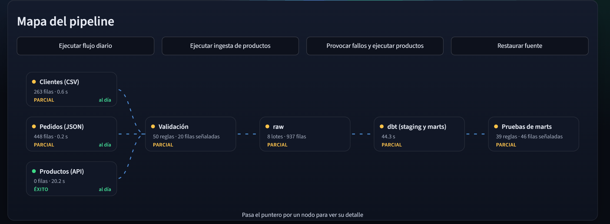 | 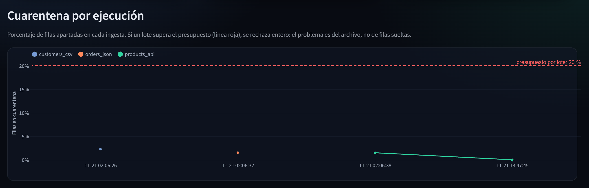 |
| Insignia «al día» en cada fuente, con su SLA en el detalle | Filas apartadas por ejecución frente al presupuesto del 20 % |

| API con guía (Swagger) | Landing: «Pruébalo» |
|:---:|:---:|
| 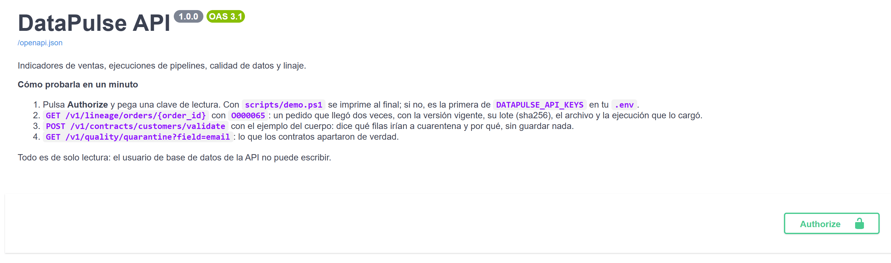 | 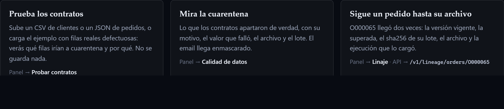 |
| Clave, primer endpoint y validador en un minuto | Tres cosas que tocar, con su enlace |

## La landing

Una página estática en [`site/`](site/) (HTML, CSS y JS puros, sin dependencias) que cuenta el
proyecto. Se prueba abriéndola desde la raíz del repo:
`python -m http.server 8791 --bind 127.0.0.1` → <http://127.0.0.1:8791/site/>.

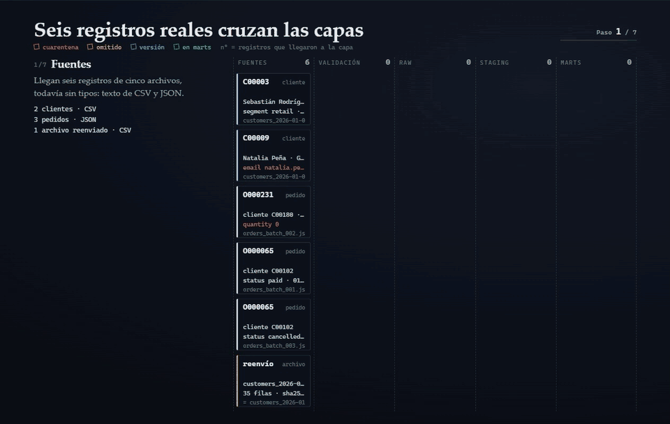

*Grabación a ritmo real: el scroll hace avanzar y retroceder seis registros reales de
`data/samples` por las capas fuentes → validación → raw → staging → marts.*

| Efecto | Técnica | Para qué |
|--------|---------|----------|
| Recorrido atado al scroll (efecto principal) | C3 *scrub* sobre una sección fija; cada ficha viaja entre carriles con `transform` | Explicar el pipeline con datos que se mueven, no con un diagrama |
| Color por capa | C13: un fondo por paso, fundido por opacidad | Saber en qué capa estás sin leer |
| Sellos y fantasmas | Sellos de tampón (cuarentena, omitido, versión), tachado de la versión vieja y copia atenuada en cada capa por la que pasó la ficha | Que el contador de cada carril cuadre con lo que se ve (raw solo añade filas) |
| Titular | B1: entra palabra a palabra | Entrada sin ruido |
| Cifras | A7: cuentan hasta su valor | Las cifras de este README |
| Terminal | H3: teclea `demo.ps1` con su salida real | Cómo se lanza, en un vistazo |

Con `prefers-reduced-motion` o sin JavaScript se ve el estado final en una lista legible. Solo
se animan `transform` y `opacity`, y en móvil (390 px) los carriles pasan a filas.

| Paso 6 de 7 (escritorio) | Móvil (390 px) |
|:---:|:---:|
| 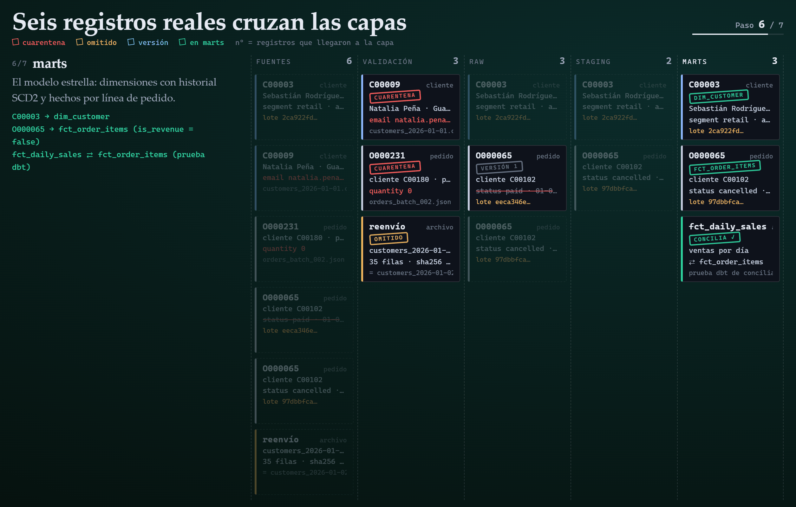 | 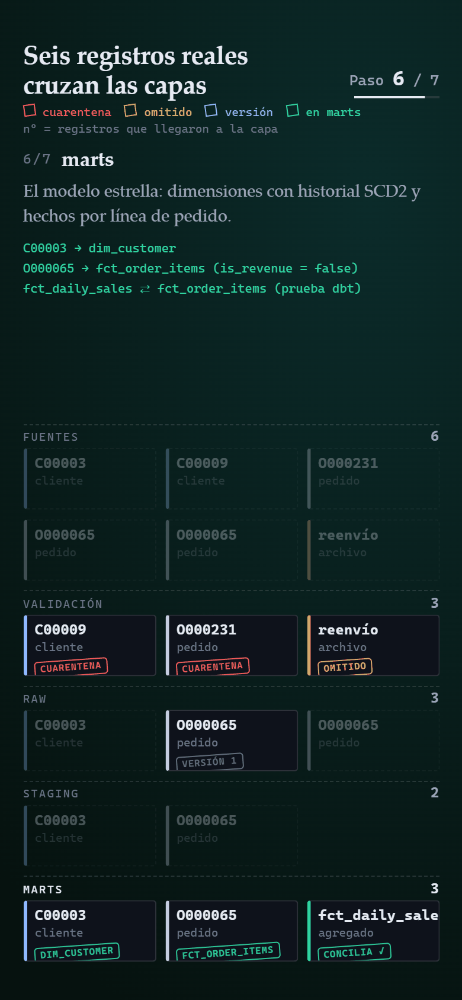 |

## Capturas

| Negocio | Pipelines |
|:---:|:---:|
|  | 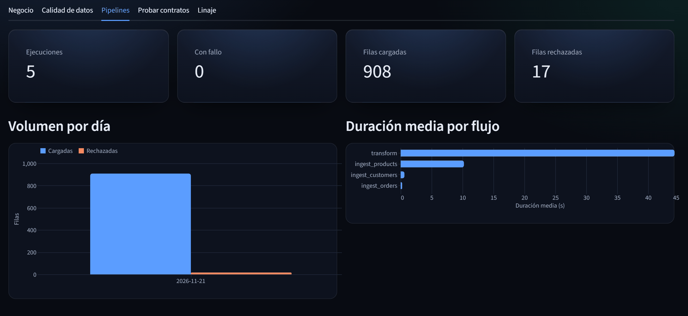 |
| Ingresos, pedidos, ticket medio y ventas por día y categoría | Ejecuciones, filas cargadas y rechazadas, duración por flujo |

| Calidad de datos | Lotes de ingesta |
|:---:|:---:|
| 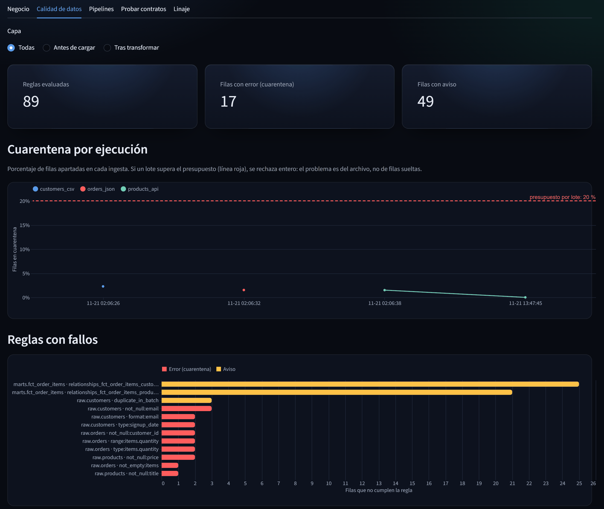 | 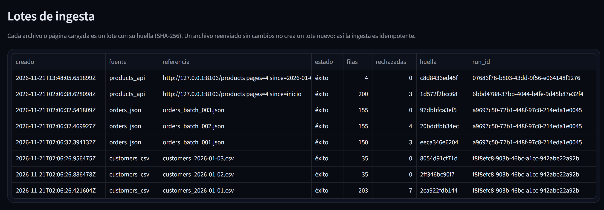 |
| Reglas evaluadas, cuarentena por ejecución y reglas con fallos | Cada lote con su huella SHA-256: un reenvío idéntico no crea lote |

| Orquestación (Prefect) |
|:---:|
| 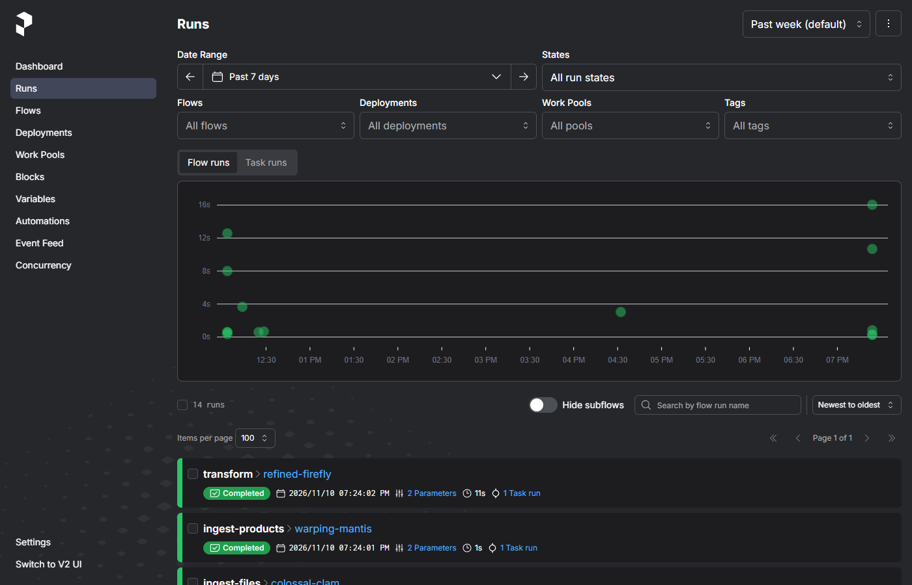 |
| Ejecuciones de los flujos `ingest-*` y `transform` |

### Evidencias de esta versión (2026-11-21)

| Comprobación | Resultado |
|--------------|-----------|
| Pruebas en local (Python 3.13, PostgreSQL 16) | Las 327 de un `pytest` sin marcas pasan; ruff, mypy `strict` y bandit, en verde |
| Stack nativo, sin Docker | Flujo diario, validador, bandeja, linaje, frescura, tendencia y caos en un clic (botón → API → Prefect → worker, con los dos intentos) |
| Navegador (Edge headless) | Escritorio, 390 px, movimiento reducido y sin JavaScript: sin errores de consola ni imágenes rotas |
| Capturas y GIF | Edge headless a 1440 px con escala 2, recortadas; los GIF se grabaron a ritmo real con el screencast del navegador |
| Rediseño anterior del panel ([PR #11](https://github.com/JuanSGarciaC/datapulse/pull/11), 2026-11-10) | CI 5 de 5, E2E 5 de 5 contra Docker |

Lo que falta por verificar con Docker está en [Limitaciones conocidas](#limitaciones-conocidas).

## Arquitectura

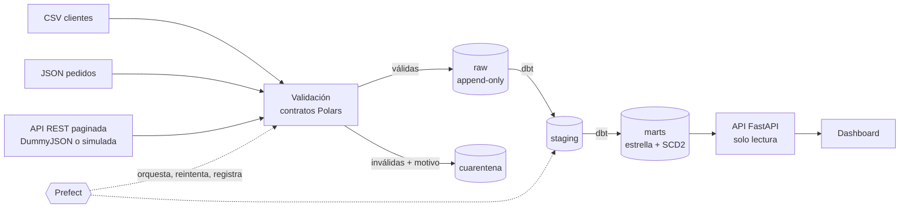

Detalle de capas y componentes en [architecture.md](docs/architecture.md).

## Stack tecnológico

| Capa | Tecnología |
|------|------------|
| Lenguaje y entorno | Python 3.13, `uv` |
| Validación | Polars, Pydantic |
| Orquestación | Prefect 3 (despliegues programados, reintentos, disparo por API) |
| Almacenamiento | PostgreSQL 16, migraciones con Alembic |
| Transformación | dbt (staging, marts, SCD2, pruebas y conciliaciones) |
| Servicio | FastAPI (indicadores) y Streamlit (dashboard) |
| Infraestructura | Docker Compose, GitHub Actions, Dependabot |
| Calidad | pytest, ruff, mypy `strict`, bandit, pip-audit, gitleaks |

## En números

Pruebas contadas el 2026-11-21 en local (Python 3.13, PostgreSQL 16): las 327 de un `pytest`
sin marcas pasan. La cobertura y el resto de cifras son del
[CI del 2026-11-10](https://github.com/JuanSGarciaC/datapulse/actions/runs/42906717769)
(ubuntu-24.04, Python 3.13, PostgreSQL en contenedor); esta versión aún no ha pasado por CI.

| | |
|---|---|
| Pruebas Python | **345**: 257 unitarias, 57 de integración contra PostgreSQL real, 26 de contrato (13 contra DummyJSON real), 5 E2E contra el stack. Un `pytest` sin marcas ejecuta 327; las 18 restantes (DummyJSON real y E2E) tienen su propio job |
| Pruebas de dbt | **39** (unicidad, relaciones, valores aceptados y 5 conciliaciones singulares) |
| Cobertura | 91 % de líneas y ramas (el CI exige ≥ 90 %); la página del panel se prueba con `AppTest`, que la herramienta de cobertura no mide |
| Defectos sintéticos | **37** documentados en `manifest.json`; una prueba exige que el pipeline los detecte **exactamente** |
| Calidad estática | ruff, mypy `strict` (código y pruebas), bandit, pip-audit, gitleaks (commits nuevos en cada push/PR; todo el historial cada semana y bajo demanda) |
| Decisiones | 9 ADRs con alternativas descartadas |

## Qué demuestra

| Tema | Cómo | Dónde |
|------|------|-------|
| Calidad de datos | Contratos por fuente, cuarentena con motivo (y su bandeja, sin datos personales), presupuesto de errores por lote, cambios de esquema a `_extra`, validador en vivo con las mismas reglas | [ADR-0007](docs/adr/0007-validation-design.md), [caso de estudio](docs/QA_CASE_STUDY.md) |
| Idempotencia | Hash de contenido por lote (un reenvío con otro nombre no se recarga), hash por registro, marcas de agua con solapamiento | [ADR-0004](docs/adr/0004-idempotency-strategy.md) |
| Resiliencia | Reintentos con `Retry-After` y *backoff* con *jitter*; carga atómica por lote; bloqueo por fuente; la marca de agua solo avanza si la carga confirma | [pipeline.md](docs/pipeline.md) |
| Orquestación real | Prefect: despliegues programados, reintentos de tarea solo ante fallos transitorios, disparo por API enlazado con `ops.pipeline_runs` | [ADR-0001](docs/adr/0001-orchestration-prefect.md) |
| Modelado analítico | Estrella con SCD2 *point-in-time*, versiones tardías, incremental probado igual a *full refresh*, índices medidos | [data-model.md](docs/data-model.md) |
| Trazabilidad | De cada línea de hecho al lote, al archivo o página de origen (sha256) y a la ejecución que lo cargó; navegable en el panel (*Linaje*) y por API | [data-model.md](docs/data-model.md#trazabilidad-de-un-indicador) |
| Mínimo privilegio | Un rol por componente; `raw` append-only; la API solo lee `marts`/`ops`; el dashboard no tiene credenciales de BD | [ADR-0005](docs/adr/0005-least-privilege-roles.md) |
| Pruebas de contrato | La misma suite contra la API simulada y contra DummyJSON real (cada push y cada semana) | [ADR-0006](docs/adr/0006-public-api-and-mock-contract.md) |
| Datos reproducibles | Generador determinista (mismos bytes en cada ejecución; LF forzado al escribir y por `.gitattributes`) con respuesta conocida | [sources.md](docs/sources.md) |
| Observabilidad | Logging JSON con redacción de secretos; ejecuciones, tareas, intentos y calidad en `ops`; dashboard operativo con mapa del pipeline, lotes de ingesta y disparo opcional de flujos | [dashboard.md](docs/dashboard.md), [ADR-0009](docs/adr/0009-dashboard-visual-system-and-trigger.md) |

## Inicio rápido

Requisitos: [Docker Desktop](https://www.docker.com/products/docker-desktop/) y Git.

**Demo en un comando (Windows, Docker Desktop abierto):**

```powershell
git clone https://github.com/JuanSGarciaC/datapulse.git
cd datapulse
.\scripts\demo.ps1
```

Crea `.env` con secretos aleatorios, levanta todo, ejecuta el pipeline y abre el dashboard.
*(Verificado en Windows 11 con Docker Desktop.)* Para apagarlo: `docker compose down`.

<details>
<summary><strong>Paso a paso (Windows, macOS o Linux)</strong></summary>

```powershell
Copy-Item .env.example .env       # Linux/macOS: cp .env.example .env
# Edita .env y cambia TODAS las contraseñas y claves "change-me-*"
docker compose up --build -d

# Carga los datos de ejemplo y ejecuta el pipeline completo (ingesta + dbt)
Copy-Item -Recurse -Force data\samples\customers, data\samples\orders data\landing\
#   Linux/macOS: cp -r data/samples/customers data/samples/orders data/landing/
docker compose run --rm worker python -m datapulse.flows run daily
```

</details>

| Servicio | Dirección (solo `127.0.0.1`) |
|----------|-------------------------------|
| **Dashboard** | <http://localhost:8501> |
| API de indicadores (Swagger) | <http://localhost:8000/docs> (cabecera `X-API-Key`) |
| Prefect UI | <http://localhost:4200> |
| API simulada (Swagger) | <http://localhost:8081/docs> |
| PostgreSQL | `localhost:5433` |

<details>
<summary><strong>Provocar fallos en la fuente y ver cómo el pipeline se recupera</strong></summary>

Con el token de tu `.env`:

```powershell
$token = (Select-String -Path .env -Pattern '^DATAPULSE_MOCK_ADMIN_TOKEN=').Line.Split('=', 2)[1]
$h = @{ 'X-Mock-Admin-Token' = $token }
Invoke-RestMethod -Method Put -Uri http://localhost:8081/_mock/faults -Headers $h `
  -ContentType 'application/json' -Body '{"fail_offsets":{"0":2},"rate_limit":3,"rate_window_s":2}'
docker compose run --rm worker python -m datapulse.flows run products
```

</details>

Guía completa (nativo, operación, rotación de secretos, copias, problemas en Windows):
[docs/deployment.md](docs/deployment.md).

## Desarrollo local (Windows, PowerShell)

Requisitos: Git, Docker Desktop (para PostgreSQL) y
[uv](https://docs.astral.sh/uv/getting-started/installation/) (`winget install astral-sh.uv`),
que instala Python 3.13 si no lo tienes.

```powershell
Copy-Item .env.example .env            # y cambia las contraseñas
.\scripts\dev.ps1 setup                # dependencias
docker compose up -d postgres
.\scripts\dev.ps1 migrate              # migraciones + usuarios de servicio
.\scripts\dev.ps1 createtestdb         # una vez: base para las pruebas de integración
.\scripts\dev.ps1 check                # lint + tipos + pruebas + seguridad (lo mismo que CI)

.\scripts\dev.ps1 mock                 # terminal 1: fuente de productos en :8081
.\scripts\dev.ps1 pipeline             # terminal 2: ingesta + dbt
.\scripts\dev.ps1 api                  # terminal 2: API (usuario de solo lectura)
.\scripts\dev.ps1 dashboard            # terminal 3: dashboard en :8501
```

Otros comandos: `generate` (regenera `data/samples`), `test-unit`, `test-live` (contrato contra
DummyJSON real), `dbt-build`, `dbt-docs`. En Linux/macOS existen en el `Makefile` con los
mismos nombres. Si PowerShell bloquea el script:
`Set-ExecutionPolicy -Scope CurrentUser RemoteSigned`.

## Pruebas

| Tipo | Qué cubre | Requiere |
|------|-----------|----------|
| Unitarias | Configuración y secretos, validación de cada fuente, cliente REST (reintentos, `Retry-After`), generador, API simulada, API (auth, validación, errores), dashboard (cliente, gráficos, mapa del pipeline, filtros, disparo y página con `AppTest`), validador en vivo (veredicto idéntico al manifiesto, topes de tamaño, JSON anidado a propósito), CORS solo para `/health`, caos contra la fuente simulada real, frescura y la landing (enlaces, cifras y fichas) | Nada |
| Integración | Migraciones (ida y vuelta, deriva), matriz de permisos, **respuesta conocida contra el manifiesto**, idempotencia, incremental, atomicidad ante fallos, bloqueo concurrente, Prefect real, dbt real (SCD2, versiones tardías, incremental = *full refresh*), cada KPI frente a un cálculo SQL independiente, dashboard contra la API real, cuarentena = defectos del manifiesto sin datos personales, linaje igual a la versión que eligió dbt, permisos de las vistas nuevas | PostgreSQL |
| Contrato | Una suite contra la API simulada y, con `-m live`, contra DummyJSON real | Internet para `live` |
| E2E | Caja negra contra el stack: disparo por la API admin → Prefect → worker → fuente con 503 y 429 → API; trazabilidad `flow_run_id` ↔ `ops`; defectos conocidos visibles por HTTP | Stack levantado (`-m e2e`) |

Las pruebas de integración se omiten localmente si no hay base de datos, pero en CI
(`CI=true`) **fallan**: un verde en CI significa que se ejecutaron. Lo mismo vale para las de
contrato y E2E.

**Verificado a mano en Windows 11 con Docker real:** `demo.ps1`, los servicios en estado
*healthy*, el mapa y las tres pestañas del dashboard con datos, el disparo de un flujo desde
el panel (el mapa se actualizó solo a los 14 s), las 5 pruebas E2E, `dev.ps1 check`
completo (lint, tipos, 286 pruebas, seguridad y muestras) y la idempotencia: una segunda
ejecución del flujo `daily` no carga filas nuevas. Las 2 advertencias de dbt son los huérfanos
sembrados a propósito en los datos de ejemplo.

**Funciones nuevas (2026-11-21), verificadas sin Docker:** con PostgreSQL 16, el servidor de
Prefect y su worker, la API y el panel corriendo de forma nativa en Windows 11. Se ejecutaron
el flujo diario (ingesta + dbt), el validador, la bandeja, el linaje, la frescura, la tendencia
y el caos en un clic: botón → API → Prefect → worker, con el intento 1 fallido y el 2 con
éxito en `ops.task_runs`. Todo se revisó en Edge (escritorio, 390 px y movimiento reducido).

## Decisiones técnicas

| ADR | Decisión | Alternativa descartada |
|-----|----------|------------------------|
| [0001](docs/adr/0001-orchestration-prefect.md) | Prefect 3 | Airflow (scheduler, webserver y BD propios: demasiada infraestructura para este volumen) |
| [0002](docs/adr/0002-dataframes-polars.md) | Polars para validar | Pandas (inferencia laxa: un entero con nulos se vuelve `float`) |
| [0003](docs/adr/0003-elt-layers-and-schema-ownership.md) | ELT por capas; Alembic dueño de `raw`/`ops`, dbt de `staging`/`marts` | ETL puro en Python (sin pruebas SQL ni linaje) |
| [0004](docs/adr/0004-idempotency-strategy.md) | Hash de contenido + hash de registro + marca de agua con solapamiento | Identificar lotes por nombre de archivo |
| [0005](docs/adr/0005-least-privilege-roles.md) | Roles de grupo en migraciones, usuarios con contraseña en un bootstrap aparte | Un usuario con todos los permisos |
| [0006](docs/adr/0006-public-api-and-mock-contract.md) | DummyJSON real + réplica simulada validada por contrato | Solo API real (no se pueden provocar fallos) o solo simulación (nada garantiza fidelidad) |
| [0007](docs/adr/0007-validation-design.md) | Validar antes de cargar, cuarentena por fila, rechazo del lote si supera el presupuesto | Cargar todo y limpiar después |
| [0008](docs/adr/0008-scd2-and-incremental-models.md) | SCD2 desde la historia de `raw`; incremental por pedido | Snapshots de dbt (dependen de cuándo se ejecuten) |
| [0009](docs/adr/0009-dashboard-visual-system-and-trigger.md) | Panel en Streamlit con sistema visual propio, mapa del pipeline en SVG y disparo opcional | Frontend aparte en React (duplica un panel ya probado y añade otra cadena de herramientas) |

## Documentación

| Documento | Contenido |
|-----------|-----------|
| [architecture.md](docs/architecture.md) | Capas, componentes y flujo de datos |
| [QA_CASE_STUDY.md](docs/QA_CASE_STUDY.md) | Caso de estudio: un defecto real, de la fuente al indicador, con cuarentena y conciliación |
| [sources.md](docs/sources.md) | Fuentes (CSV, JSON, REST), contratos y defectos sintéticos |
| [pipeline.md](docs/pipeline.md) | Validación, cuarentena, idempotencia, reintentos y recuperación |
| [data-model.md](docs/data-model.md) | Modelo estrella, granularidad, pruebas de dbt y rendimiento |
| [api.md](docs/api.md) | Endpoints, autenticación y ejemplos |
| [dashboard.md](docs/dashboard.md) | Pestañas del dashboard y capturas |
| [deployment.md](docs/deployment.md) | Docker Compose, Windows, operación, rotación de secretos |
| [docs/adr/](docs/adr) | Decisiones de arquitectura (8 ADRs) |
| [CONTRIBUTING.md](CONTRIBUTING.md) | Cómo contribuir: entorno, reglas y commits |
| [SECURITY.md](SECURITY.md) | Cómo reportar una vulnerabilidad en privado |

## Estructura

```
src/datapulse/
  config.py        configuración tipada (pydantic-settings); secretos como SecretStr
  db/              tablas de Alembic, engine y bootstrap de usuarios con mínimo privilegio
  synthetic/       generador determinista con defectos documentados
  mock_source/     API simulada (contrato DummyJSON + fallos, rate limit y reloj)
  sources/         contrato Pydantic de la API de productos
  validation/      contratos por fuente y motores de validación (Polars)
  ingestion/       cliente REST con reintentos, carga idempotente y atómica, CLI
  flows/           flujos y despliegues de Prefect
  transform/       dbt desde Python (dbtRunner) y registro de sus pruebas en ops
  api/             API de indicadores (FastAPI, solo lectura salvo el disparo admin)
  dashboard/       Streamlit: cliente de la API, gráficos, mapa del pipeline, tema y página
dbt/               staging, marts, pruebas genéricas y conciliaciones
migrations/        Alembic: esquemas, roles, permisos, tablas raw y ops
data/samples/      datos de ejemplo versionados + manifest.json
tests/             unit, integration, contract, e2e
docs/              arquitectura, fuentes, pipeline, modelo, API, dashboard, despliegue, ADRs
scripts/           demo.ps1 (demo en un comando), dev.ps1 (comandos para Windows) y
                   screenshots.py (capturas y comprobación visual en un navegador)
```

## Seguridad

- Ningún secreto se versiona: `.env` está en `.gitignore`; `.env.example` solo trae valores de
  ejemplo, y con `DATAPULSE_ENV=prod` **la aplicación se niega a arrancar** si quedan `change-me-*`.
- Contraseñas y claves como `SecretStr` (no aparecen en `repr`, logs ni errores); los logs
  redactan además claves sensibles pasadas por error.
- Cada componente usa su propio usuario de BD con permisos mínimos, verificados por pruebas
  contra el catálogo de PostgreSQL y, en CI, dentro de los contenedores.
- API con claves por consumidor (rotables) comparadas en tiempo constante; nunca en la URL.
- Todos los servicios se publican solo en `127.0.0.1`; los contenedores corren como uid 10001.
- Actions de GitHub fijadas por SHA; Dependabot para actions y dependencias.
- Datos 100 % sintéticos; los correos usan `example.com` (dominio reservado, RFC 2606).

## Limitaciones conocidas

Lo que el proyecto **no** hace o no se pudo verificar:

- **Lo nuevo de Docker Compose y `demo.ps1` (2026-11-21) no se ejecutó con Docker:** las
  variables de la demo de caos en el panel, la clave que imprime `demo.ps1` y que la imagen
  incluya los ejemplos del validador. Las funciones sí se verificaron con el stack nativo
  (ver [Pruebas](#pruebas)). Para cerrarlo: `.\scripts\demo.ps1` y `uv run pytest -m e2e`.

- **`scripts/dev.ps1`:** en Windows 11 se ejecutaron `setup`, `createtestdb`, `migrate` y `check`.
  Los comandos que arrancan procesos de larga duración (`mock`, `api`, `dashboard`, `pipeline`)
  no se probaron de forma nativa en Windows; Docker Compose es la vía verificada de punta a punta.
- **Carga incremental con escaneo completo:** DummyJSON no filtra por fecha, así que cada
  ejecución lee todo el catálogo y filtra en el cliente. Con 200 productos es trivial; con
  millones haría falta una fuente que filtre en el servidor o CDC.
- **El acabado visual del panel depende de selectores internos de Streamlit** (`data-testid`).
  Una versión nueva puede cambiarlos: el panel seguiría funcionando sin el acabado.
  `scripts/screenshots.py` lo detecta, pero se ejecuta a mano, no en CI.
- **Pensado para una máquina:** sin TLS, sin login en el dashboard, Prefect sin autenticación y
  sin límite de peticiones en la API. La lista de cambios para un entorno real está en
  [deployment.md](docs/deployment.md#4-antes-de-un-entorno-real).
- **`rows_evaluated` de las pruebas de dbt es desconocido:** dbt informa las filas que fallan,
  no las evaluadas; se registra así y se marca en `details`.
- **dbt-core copia el `.env` a las variables del proceso** al importarse; DataPulse lo confina
  ([pipeline.md](docs/pipeline.md#hallazgo-dbt-core-copia-el-env-a-las-variables-del-proceso)),
  pero es un comportamiento de la dependencia.

## Licencia

Todos los derechos reservados. El código se publica para consulta como parte de mi portafolio: puedes leerlo, pero no usarlo, copiarlo, modificarlo ni distribuirlo sin mi autorización por escrito. Ver [LICENSE](LICENSE). Hecho por [JuanSGarciaC](https://github.com/JuanSGarciaC).
