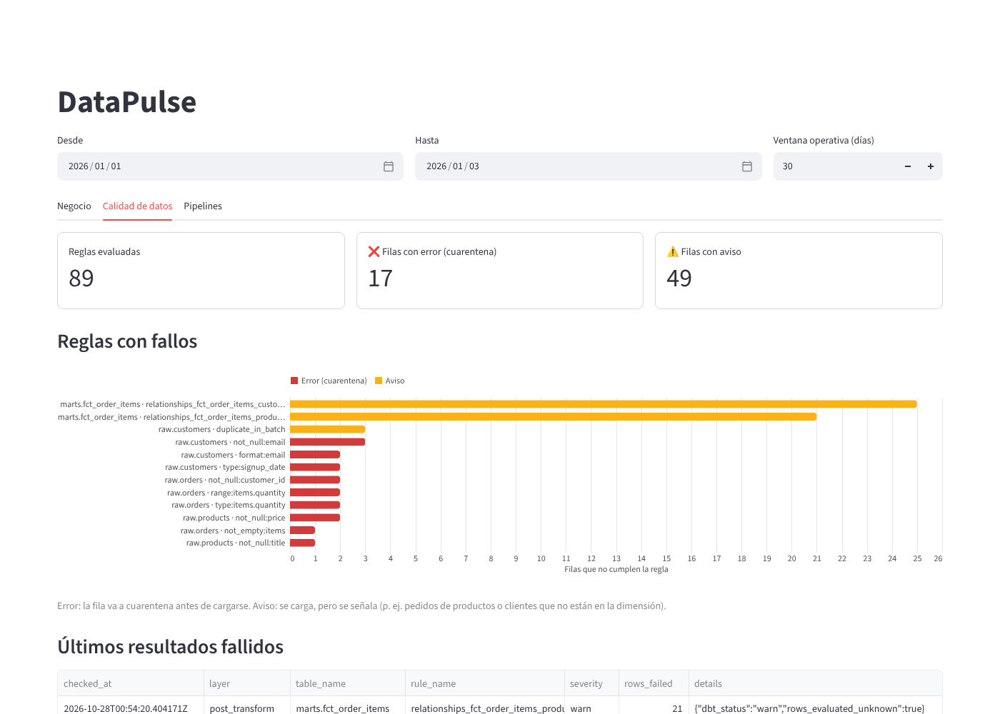
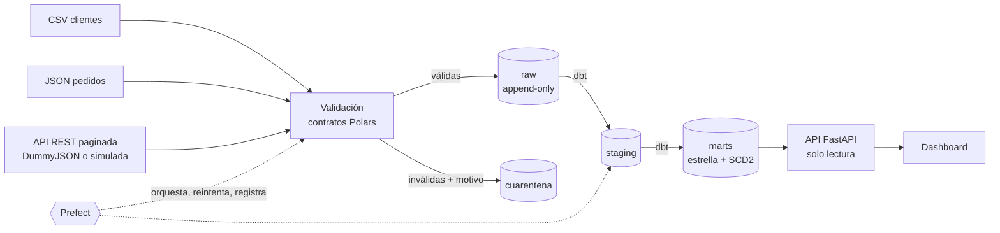

# DataPulse

[](https://github.com/JuanSGarciaC/datapulse/actions/workflows/ci.yml)


Plataforma de ingeniería de datos que convierte archivos (CSV, JSON) y una API REST paginada en
información **confiable, trazable e idempotente** para análisis de negocio: ingesta validada con
cuarentena, orquestación con Prefect, modelo estrella con dbt, API de indicadores y dashboard.





**Todo lo que se describe aquí está implementado y se verifica en CI en cada push**, incluida una
prueba de extremo a extremo contra el stack levantado en contenedores. Lo que no se pudo
verificar está en [Limitaciones conocidas](#limitaciones-conocidas).

## En números

| | |
|---|---|
| Pruebas Python | **290**: 209 unitarias, 50 de integración contra PostgreSQL real, 26 de contrato (13 contra DummyJSON real), 5 E2E contra el stack |
| Pruebas de dbt | **39** (unicidad, relaciones, valores aceptados y 5 conciliaciones singulares) |
| Cobertura | 93 % de líneas y ramas (el CI exige ≥ 90 %) |
| Defectos sintéticos | **37** documentados en `manifest.json`; una prueba exige que el pipeline los detecte **exactamente** |
| Calidad estática | ruff, mypy `strict` (código y pruebas), bandit, pip-audit, gitleaks sobre todo el historial |
| Decisiones | 8 ADRs con alternativas descartadas |

## Qué demuestra

| Tema | Cómo | Dónde |
|------|------|-------|
| Calidad de datos | Contratos por fuente, cuarentena con motivo, presupuesto de errores por lote, cambios de esquema a `_extra` | [ADR-0007](docs/adr/0007-validation-design.md) |
| Idempotencia | Hash de contenido por lote (un reenvío con otro nombre no se recarga), hash por registro, marcas de agua con solapamiento | [ADR-0004](docs/adr/0004-idempotency-strategy.md) |
| Resiliencia | Reintentos con `Retry-After` y *backoff* con *jitter*; carga atómica por lote; bloqueo por fuente; la marca de agua solo avanza si la carga confirma | [pipeline.md](docs/pipeline.md) |
| Orquestación real | Prefect: despliegues programados, reintentos de tarea solo ante fallos transitorios, disparo por API enlazado con `ops.pipeline_runs` | [ADR-0001](docs/adr/0001-orchestration-prefect.md) |
| Modelado analítico | Estrella con SCD2 *point-in-time*, versiones tardías, incremental probado igual a *full refresh*, índices medidos | [data-model.md](docs/data-model.md) |
| Trazabilidad | De cada línea de hecho al lote, al archivo o página de origen (sha256) y a la ejecución que lo cargó | [data-model.md](docs/data-model.md#trazabilidad-de-un-indicador) |
| Mínimo privilegio | Un rol por componente; `raw` append-only; la API solo lee `marts`/`ops`; el dashboard no tiene credenciales de BD | [ADR-0005](docs/adr/0005-least-privilege-roles.md) |
| Pruebas de contrato | La misma suite contra la API simulada y contra DummyJSON real (cada push y cada semana) | [ADR-0006](docs/adr/0006-public-api-and-mock-contract.md) |
| Datos reproducibles | Generador determinista (mismos bytes en cada ejecución; LF forzado al escribir y por `.gitattributes`) con respuesta conocida | [sources.md](docs/sources.md) |
| Observabilidad | Logging JSON con redacción de secretos; ejecuciones, tareas, intentos y calidad en `ops`; dashboard operativo | [dashboard.md](docs/dashboard.md) |

## Inicio rápido (Docker, Windows/macOS/Linux)

Requisitos: [Docker Desktop](https://www.docker.com/products/docker-desktop/) y Git.

```powershell
git clone https://github.com/JuanSGarciaC/datapulse.git
cd datapulse
Copy-Item .env.example .env       # Linux/macOS: cp .env.example .env
# Edita .env y cambia TODAS las contraseñas y claves "change-me-*"
docker compose up --build -d

# Carga los datos de ejemplo y ejecuta el pipeline completo (ingesta + dbt)
Copy-Item -Recurse -Force data\samples\customers, data\samples\orders data\landing\
#   Linux/macOS: cp -r data/samples/customers data/samples/orders data/landing/
docker compose run --rm worker python -m datapulse.flows run daily
```

| Servicio | Dirección (solo `127.0.0.1`) |
|----------|-------------------------------|
| **Dashboard** | <http://localhost:8501> |
| API de indicadores (Swagger) | <http://localhost:8000/docs> (cabecera `X-API-Key`) |
| Prefect UI | <http://localhost:4200> |
| API simulada (Swagger) | <http://localhost:8081/docs> |
| PostgreSQL | `localhost:5433` |

Provocar fallos en la fuente y ver cómo el pipeline se recupera (token de tu `.env`):

```powershell
$token = (Select-String -Path .env -Pattern '^DATAPULSE_MOCK_ADMIN_TOKEN=').Line.Split('=', 2)[1]
$h = @{ 'X-Mock-Admin-Token' = $token }
Invoke-RestMethod -Method Put -Uri http://localhost:8081/_mock/faults -Headers $h `
  -ContentType 'application/json' -Body '{"fail_offsets":{"0":2},"rate_limit":3,"rate_window_s":2}'
docker compose run --rm worker python -m datapulse.flows run products
```

Guía completa (nativo, operación, rotación de secretos, copias, problemas en Windows):
[docs/deployment.md](docs/deployment.md).

## Desarrollo local (Windows, PowerShell)

Requisitos: Git, Docker Desktop (para PostgreSQL) y
[uv](https://docs.astral.sh/uv/getting-started/installation/) (`winget install astral-sh.uv`),
que instala Python 3.13 si no lo tienes.

```powershell
Copy-Item .env.example .env            # y cambia las contraseñas
.\scripts\dev.ps1 setup                # dependencias
docker compose up -d postgres
.\scripts\dev.ps1 migrate              # migraciones + usuarios de servicio
.\scripts\dev.ps1 createtestdb         # una vez: base para las pruebas de integración
.\scripts\dev.ps1 check                # lint + tipos + pruebas + seguridad (lo mismo que CI)

.\scripts\dev.ps1 mock                 # terminal 1: fuente de productos en :8081
.\scripts\dev.ps1 pipeline             # terminal 2: ingesta + dbt
.\scripts\dev.ps1 api                  # terminal 2: API (usuario de solo lectura)
.\scripts\dev.ps1 dashboard            # terminal 3: dashboard en :8501
```

Otros comandos: `generate` (regenera `data/samples`), `test-unit`, `test-live` (contrato contra
DummyJSON real), `dbt-build`, `dbt-docs`. En Linux/macOS existen en el `Makefile` con los
mismos nombres. Si PowerShell bloquea el script:
`Set-ExecutionPolicy -Scope CurrentUser RemoteSigned`.

## Pruebas

| Tipo | Qué cubre | Requiere |
|------|-----------|----------|
| Unitarias | Configuración y secretos, validación de cada fuente, cliente REST (reintentos, `Retry-After`), generador, API simulada, API (auth, validación, errores), dashboard (cliente, gráficos y página con `AppTest`) | Nada |
| Integración | Migraciones (ida y vuelta, deriva), matriz de permisos, **respuesta conocida contra el manifiesto**, idempotencia, incremental, atomicidad ante fallos, bloqueo concurrente, Prefect real, dbt real (SCD2, versiones tardías, incremental = *full refresh*), cada KPI frente a un cálculo SQL independiente, dashboard contra la API real | PostgreSQL |
| Contrato | Una suite contra la API simulada y, con `-m live`, contra DummyJSON real | Internet para `live` |
| E2E | Caja negra contra el stack: disparo por la API admin → Prefect → worker → fuente con 503 y 429 → API; trazabilidad `flow_run_id` ↔ `ops`; defectos conocidos visibles por HTTP | Stack levantado (`-m e2e`) |

Las pruebas de integración se omiten localmente si no hay base de datos, pero en CI
(`CI=true`) **fallan**: un verde en CI significa que se ejecutaron. Lo mismo vale para las de
contrato y E2E.

## Documentación

| Documento | Contenido |
|-----------|-----------|
| [architecture.md](docs/architecture.md) | Capas, componentes y flujo de datos |
| [sources.md](docs/sources.md) | Fuentes (CSV, JSON, REST), contratos y defectos sintéticos |
| [pipeline.md](docs/pipeline.md) | Validación, cuarentena, idempotencia, reintentos y recuperación |
| [data-model.md](docs/data-model.md) | Modelo estrella, granularidad, pruebas de dbt y rendimiento |
| [api.md](docs/api.md) | Endpoints, autenticación y ejemplos |
| [dashboard.md](docs/dashboard.md) | Pestañas del dashboard y capturas |
| [deployment.md](docs/deployment.md) | Docker Compose, Windows, operación, rotación de secretos |
| [docs/adr/](docs/adr) | Decisiones de arquitectura (8 ADRs) |

## Verificación local (sin Docker)

Con PostgreSQL 16 activo y el `.env` cargado, `make check` ejecuta lint, tipos, las 272
pruebas unitarias y de integración (93 % de cobertura), bandit, pip-audit y la comprobación
de las muestras. El flujo `daily` también se ejecutó a mano de punta a punta: migraciones,
API simulada, ingesta, dbt (47 pruebas correctas y 2 avisos de huérfanos esperados, sin
errores) y API de indicadores. Una segunda ejecución no carga filas nuevas (idempotencia).

## Decisiones técnicas

| ADR | Decisión | Alternativa descartada |
|-----|----------|------------------------|
| [0001](docs/adr/0001-orchestration-prefect.md) | Prefect 3 | Airflow (scheduler, webserver y BD propios: demasiada infraestructura para este volumen) |
| [0002](docs/adr/0002-dataframes-polars.md) | Polars para validar | Pandas (inferencia laxa: un entero con nulos se vuelve `float`) |
| [0003](docs/adr/0003-elt-layers-and-schema-ownership.md) | ELT por capas; Alembic dueño de `raw`/`ops`, dbt de `staging`/`marts` | ETL puro en Python (sin pruebas SQL ni linaje) |
| [0004](docs/adr/0004-idempotency-strategy.md) | Hash de contenido + hash de registro + marca de agua con solapamiento | Identificar lotes por nombre de archivo |
| [0005](docs/adr/0005-least-privilege-roles.md) | Roles de grupo en migraciones, usuarios con contraseña en un bootstrap aparte | Un usuario con todos los permisos |
| [0006](docs/adr/0006-public-api-and-mock-contract.md) | DummyJSON real + réplica simulada validada por contrato | Solo API real (no se pueden provocar fallos) o solo simulación (nada garantiza fidelidad) |
| [0007](docs/adr/0007-validation-design.md) | Validar antes de cargar, cuarentena por fila, rechazo del lote si supera el presupuesto | Cargar todo y limpiar después |
| [0008](docs/adr/0008-scd2-and-incremental-models.md) | SCD2 desde la historia de `raw`; incremental por pedido | Snapshots de dbt (dependen de cuándo se ejecuten) |

## Estructura

```
src/datapulse/
  config.py        configuración tipada (pydantic-settings); secretos como SecretStr
  db/              tablas de Alembic, engine y bootstrap de usuarios con mínimo privilegio
  synthetic/       generador determinista con defectos documentados
  mock_source/     API simulada (contrato DummyJSON + fallos, rate limit y reloj)
  sources/         contrato Pydantic de la API de productos
  validation/      contratos por fuente y motores de validación (Polars)
  ingestion/       cliente REST con reintentos, carga idempotente y atómica, CLI
  flows/           flujos y despliegues de Prefect
  transform/       dbt desde Python (dbtRunner) y registro de sus pruebas en ops
  api/             API de indicadores (FastAPI, solo lectura salvo el disparo admin)
  dashboard/       Streamlit: cliente de la API, gráficos y página
dbt/               staging, marts, pruebas genéricas y conciliaciones
migrations/        Alembic: esquemas, roles, permisos, tablas raw y ops
data/samples/      datos de ejemplo versionados + manifest.json
tests/             unit, integration, contract, e2e
docs/              arquitectura, fuentes, pipeline, modelo, API, dashboard, despliegue, ADRs
scripts/dev.ps1    comandos para Windows
```

## Seguridad

- Ningún secreto se versiona: `.env` está en `.gitignore`; `.env.example` solo trae valores de
  ejemplo, y con `DATAPULSE_ENV=prod` **la aplicación se niega a arrancar** si quedan `change-me-*`.
- Contraseñas y claves como `SecretStr` (no aparecen en `repr`, logs ni errores); los logs
  redactan además claves sensibles pasadas por error.
- Cada componente usa su propio usuario de BD con permisos mínimos, verificados por pruebas
  contra el catálogo de PostgreSQL y, en CI, dentro de los contenedores.
- API con claves por consumidor (rotables) comparadas en tiempo constante; nunca en la URL.
- Todos los servicios se publican solo en `127.0.0.1`; los contenedores corren como uid 10001.
- Actions de GitHub fijadas por SHA; Dependabot para actions y dependencias.
- Datos 100 % sintéticos; los correos usan `example.com` (dominio reservado, RFC 2606).

## Limitaciones conocidas

Lo que el proyecto **no** hace o no se pudo verificar:

- **`scripts/dev.ps1` no se ejecutó en un Windows real** (el entorno de desarrollo no tenía
  PowerShell). Los comandos que llama sí están verificados; Docker Compose es la vía probada.
- **Carga incremental con escaneo completo:** DummyJSON no filtra por fecha, así que cada
  ejecución lee todo el catálogo y filtra en el cliente. Con 200 productos es trivial; con
  millones haría falta una fuente que filtre en el servidor o CDC.
- **Pensado para una máquina:** sin TLS, sin login en el dashboard, Prefect sin autenticación y
  sin límite de peticiones en la API. La lista de cambios para un entorno real está en
  [deployment.md](docs/deployment.md#4-antes-de-un-entorno-real).
- **`rows_evaluated` de las pruebas de dbt es desconocido:** dbt informa las filas que fallan,
  no las evaluadas; se registra así y se marca en `details`.
- **dbt-core copia el `.env` a las variables del proceso** al importarse; DataPulse lo confina
  ([pipeline.md](docs/pipeline.md#hallazgo-dbt-core-copia-el-env-a-las-variables-del-proceso)),
  pero es un comportamiento de la dependencia.

## Licencia

[MIT](LICENSE)
