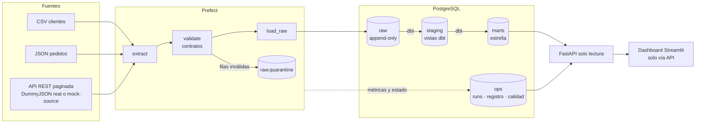
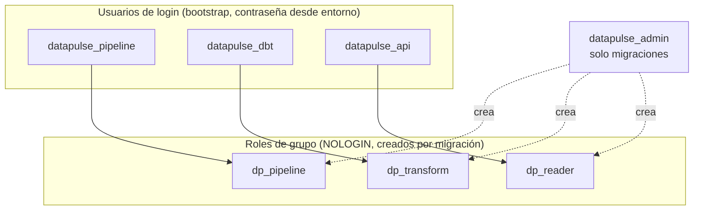
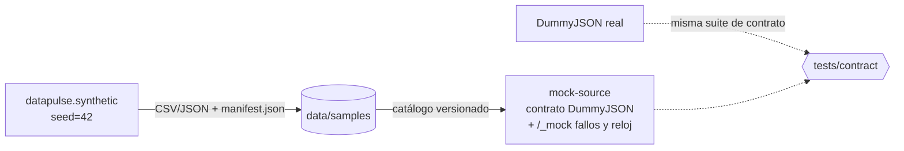

# Arquitectura de DataPulse

> Estado: **Fases 1 a 7 implementadas** (fundaciones, datos y API simulada, ingesta, orquestación, modelado dbt, API y dashboard). Modelo detallado en [data-model.md](data-model.md).
> Los componentes marcados con *(fase N)* están diseñados pero aún no existen en el código.

## Vista general

## Capas y propiedad

| Esquema   | Contenido                                   | Gestionado por | Escribe        | Lee                     |
|-----------|---------------------------------------------|----------------|----------------|-------------------------|
| `raw`     | Datos tal como llegaron + columnas técnicas | Alembic        | `dp_pipeline` (solo INSERT) | `dp_transform` |
| `staging` | Limpieza, tipado, deduplicación (vistas)    | dbt            | `dp_transform` | —                       |
| `marts`   | Hechos y dimensiones                        | dbt            | `dp_transform` | `dp_reader` (API)       |
| `ops`     | Ejecuciones, lotes, marcas de agua, calidad | Alembic        | `dp_pipeline`  | `dp_reader` (API)       |

**Por qué así:** cada herramienta es dueña de sus objetos (Alembic nunca toca tablas de dbt
y viceversa), y la API no puede ver datos sin procesar ni modificar nada. Ver
[ADR-0003](adr/0003-elt-layers-and-schema-ownership.md) y [ADR-0005](adr/0005-least-privilege-roles.md).

## Roles y usuarios

Cada usuario tiene `SET role` por defecto a su grupo. Consecuencia práctica: las tablas que
crea dbt pertenecen a `dp_transform` (no al usuario concreto), por lo que los privilegios por
defecto que dan `SELECT` a la API se aplican siempre.

## Modelo operativo (`ops`) — implementado

| Tabla                | Granularidad                         | Clave                          | Uso                                    |
|----------------------|--------------------------------------|--------------------------------|----------------------------------------|
| `pipeline_runs`      | 1 fila por ejecución de flujo        | `run_id`                       | Estado, duración, volúmenes, error     |
| `task_runs`          | 1 fila por intento de tarea          | `task_run_id`                  | Reintentos y tiempos por etapa         |
| `ingestion_registry` | 1 fila por lote único de una fuente  | `batch_id`; único `(source_name, content_sha256)` | Idempotencia de archivos y trazabilidad |
| `watermarks`         | 1 fila por fuente incremental        | `source_name`                  | Carga incremental de la API            |
| `quality_results`    | 1 fila por regla evaluada en un lote | `id`                           | Dashboard de calidad                   |

Los estados se validan con `CHECK` constraints (no `ENUM`), ver ADR-0003.

## Trazabilidad (diseño)

`marts.fct_*._batch_id` → `ops.ingestion_registry` (archivo/página + sha256) →
`ops.pipeline_runs` (cuándo, quién lo disparó, resultado). dbt docs aporta el linaje entre modelos.

## Componentes de despliegue

| Servicio        | Fase | Motivo                                               |
|-----------------|------|------------------------------------------------------|
| `postgres`      | 1 ✅ | Almacenamiento de todas las capas                     |
| `migrate`       | 1 ✅ | Migraciones + usuarios de servicio (one-shot, idempotente) |
| `mock-source`   | 2 ✅ | API externa simulada con fallos inyectables (prueba)  |
| `prefect-server`| 4 ✅ | Estado de flujos, programación, UI                   |
| `worker`        | 4 ✅ | Ejecuta los flujos                                   |
| `api`           | 6 ✅ | Indicadores y resultados de pipelines                 |
| `dashboard`     | 7 ✅ | Calidad, volúmenes, tiempos y errores                 |

## Fuentes y simulación (fase 2)

Detalle completo en [sources.md](sources.md) y [ADR-0006](adr/0006-public-api-and-mock-contract.md).

