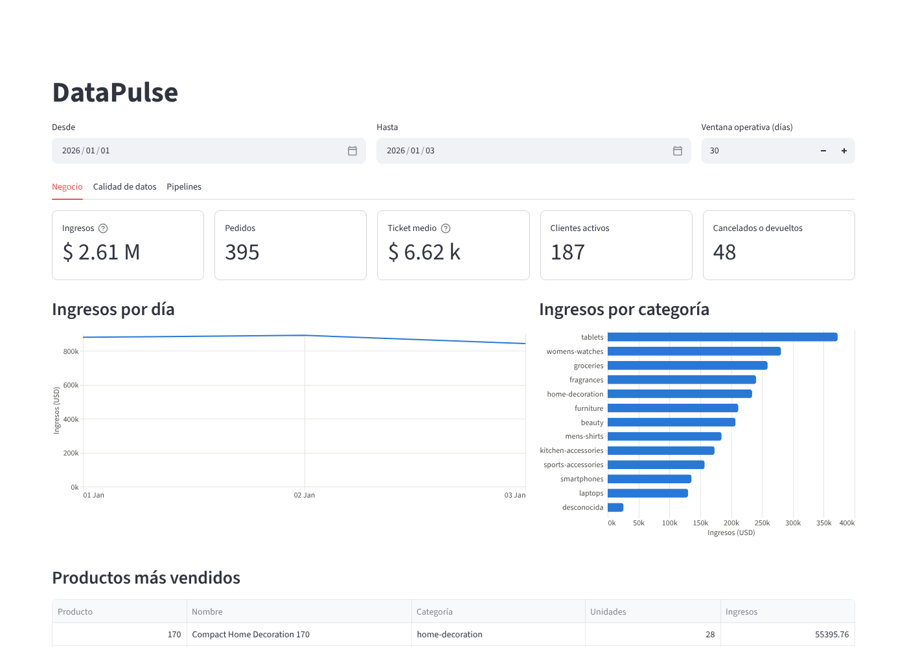
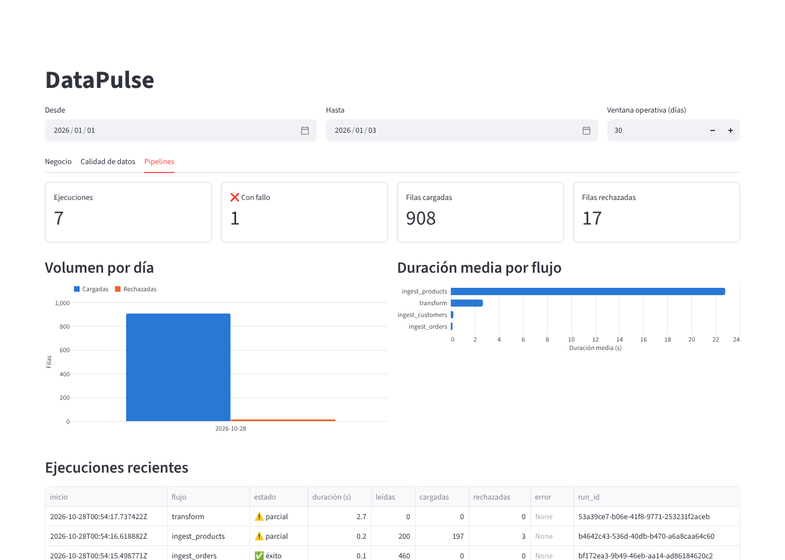

# Dashboard

Streamlit, en <http://localhost:8501> con Docker Compose o con `.\scripts\dev.ps1 dashboard`.

## Principio de diseño: el dashboard es un cliente más de la API

El dashboard **no tiene credenciales de base de datos**. Todo lo que muestra llega por la API
con una clave de lectura propia (`DATAPULSE_DASHBOARD_API_KEY`), revocable sin afectar a otros
consumidores. Consecuencias:

- Si la API no expone un dato, el dashboard tampoco puede mostrarlo: prueba que la API basta
  para un cliente real.
- Un fallo de la API en una pestaña se muestra en esa pestaña sin tumbar las otras.
- `tests/integration/test_api.py::test_dashboard_page_renders_with_real_data` renderiza la
  página completa contra la API real y un almacén cargado por el pipeline: si la API cambia su
  contrato, esa prueba falla.

## Vistas

| Pestaña | Qué responde | Fuente (API) |
|---------|--------------|--------------|
| **Negocio** | ¿Cuánto vendimos, a quién y qué? Ingresos, pedidos, ticket medio, clientes activos, cancelaciones; ingresos por día y categoría; productos más vendidos | `/v1/kpis/summary`, `/v1/sales/*`, `/v1/products/top` |
| **Calidad de datos** | ¿Qué datos rechazamos o señalamos y por qué? Reglas evaluadas, filas en cuarentena (error) y avisos, por regla | `/v1/quality/summary`, `/v1/quality/results` |
| **Pipelines** | ¿Funcionan los pipelines? Ejecuciones, fallos, filas cargadas/rechazadas por día, duración por flujo, detalle por tarea y error de cada ejecución | `/v1/pipeline-runs`, `/v1/metrics/volumes` |

*Capturas con los datos sintéticos de `data/samples` tras dos ejecuciones del flujo diario.
La ejecución con fallo es real: la primera vez la fuente de productos no era alcanzable, los
reintentos se agotaron (por eso `ingest_products` tiene la duración media más alta) y el error
quedó registrado con su causa; la segunda ejecución omitió los archivos ya cargados (0 filas
nuevas de clientes y pedidos) y cargó los productos.*

## Cómo leer los números de calidad

- **Error (rojo):** la fila no se carga; va a `raw.quarantine` con el motivo.
- **Aviso (ámbar):** la fila se carga pero se señala. Los avisos de relaciones (21 y 25 filas) son
  mayores que los 4 huérfanos del manifiesto porque la cuarentena se propaga: los pedidos de un
  cliente rechazado quedan sin dimensión. El desglose exacto está en
  [data-model.md](data-model.md#por-qué-las-relaciones-son-un-aviso-y-no-un-error).

## Decisiones de visualización

- Un eje Y por gráfico; medidas de escala distinta van en gráficos distintos.
- Una serie → un color y sin leyenda; dos o más series → leyenda siempre.
- Rojo y ámbar se reservan para estados y siempre van acompañados de texto (no solo color).
- Las tarjetas usan cifras compactas (`$ 2.61 M`) con el valor exacto en la ayuda, para que
  nunca se trunquen.
- Cada gráfico tiene una tabla equivalente (vista accesible).

## Endurecimiento

Streamlit se arranca con telemetría desactivada (`browser.gatherUsageStats=false`), protección
XSRF, modo *headless*, barra de herramientas mínima y publicado solo en `127.0.0.1`.
