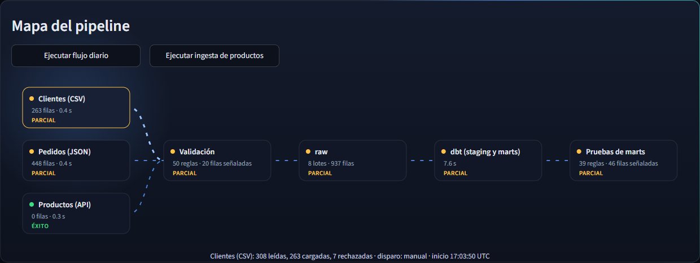
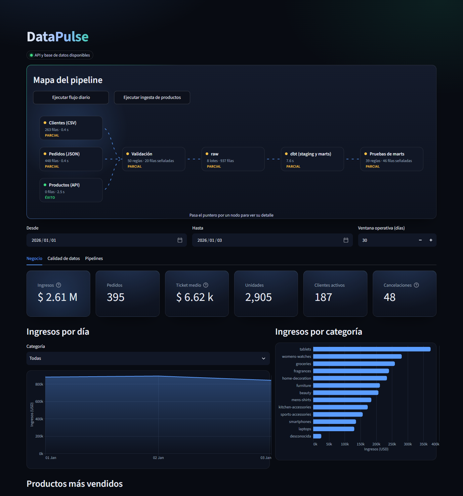
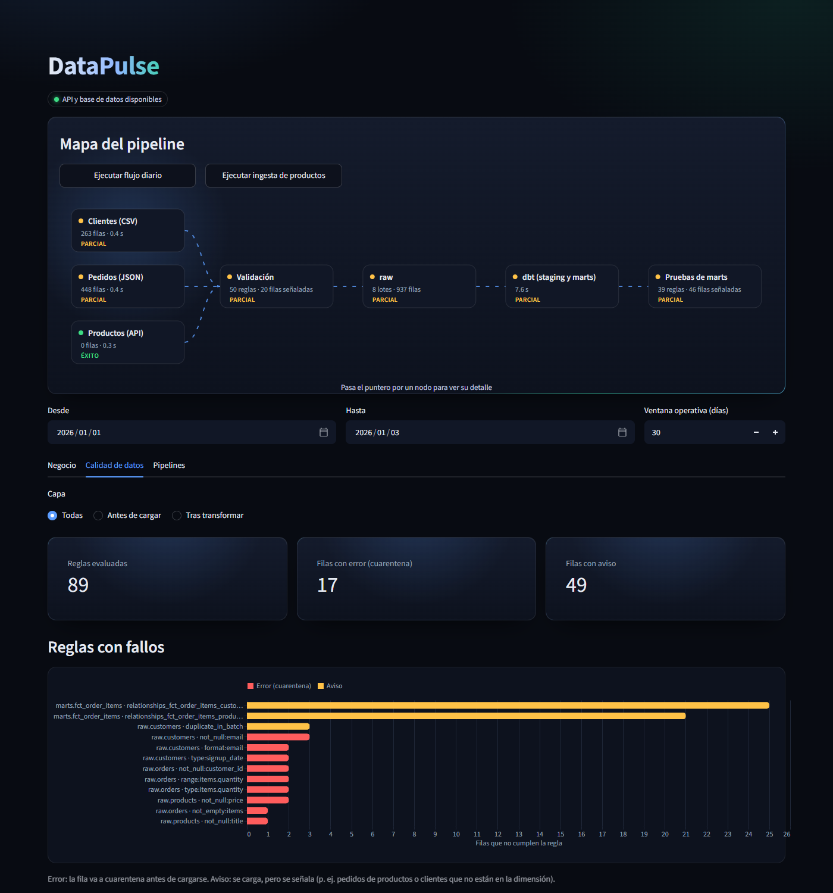
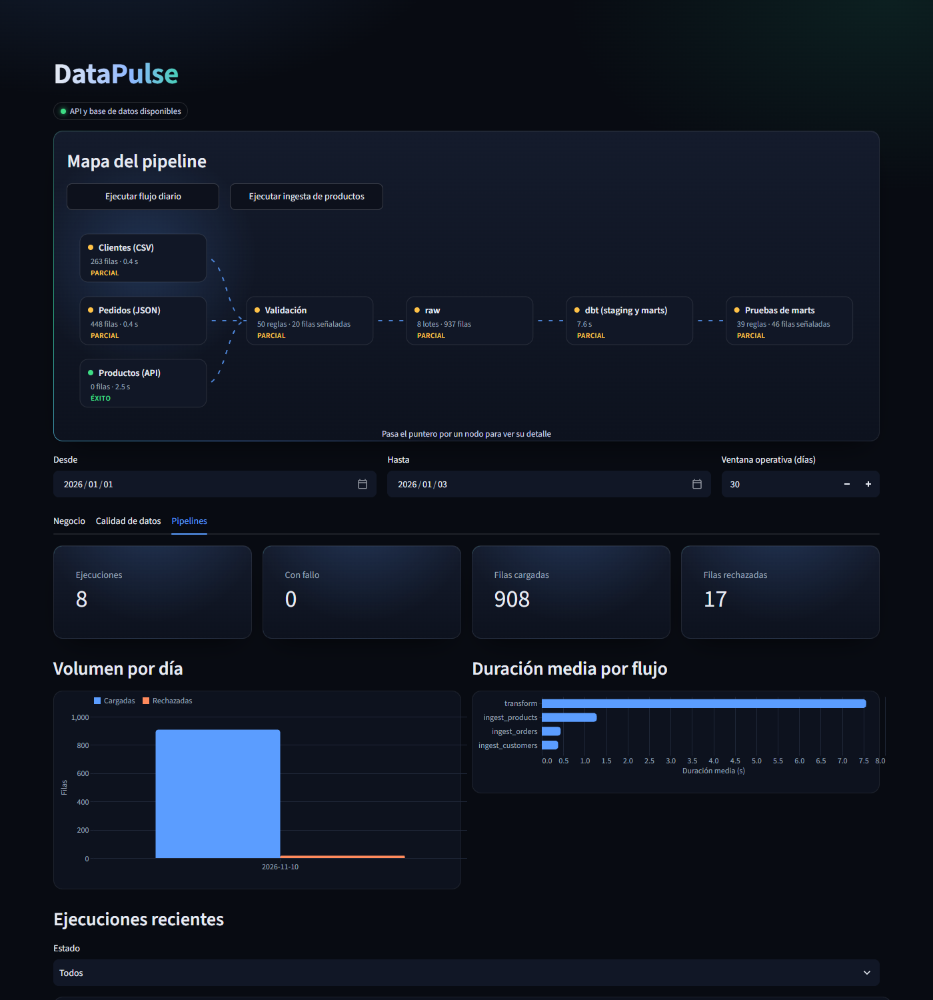

# Dashboard

Streamlit, en <http://localhost:8501> con Docker Compose o con `.\scripts\dev.ps1 dashboard`.

## Principio de diseño: el dashboard es un cliente más de la API

El dashboard **no tiene credenciales de base de datos**. Todo lo que muestra llega por la API
con una clave de lectura propia (`DATAPULSE_DASHBOARD_API_KEY`), revocable sin afectar a otros
consumidores. Consecuencias:

- Si la API no expone un dato, el dashboard tampoco puede mostrarlo: prueba que la API basta
  para un cliente real.
- Un fallo de la API en una pestaña se muestra en esa pestaña sin tumbar las otras.
- `tests/integration/test_api.py::test_dashboard_page_renders_with_real_data` renderiza la
  página completa contra la API real y un almacén cargado por el pipeline: si la API cambia su
  contrato, esa prueba falla.

## Mapa del pipeline

Encima de las pestañas, el recorrido completo de los datos: fuentes → validación → `raw` →
dbt → pruebas de marts. Cada nodo muestra el estado de su última ejecución, con texto y color.

- Una arista **fluye** solo si por ella ya pasaron datos.
- Un nodo **late** mientras su flujo está en curso.
- Al pasar el puntero (o el foco del teclado) por un nodo se ve su detalle y se encienden sus
  aristas.

### Disparar un pipeline desde el panel (opcional)

Si se define `DATAPULSE_DASHBOARD_ADMIN_KEY` (el mismo valor que `DATAPULSE_API_ADMIN_KEY`),
el mapa ofrece dos botones: **Ejecutar flujo diario** y **Ejecutar ingesta de productos**.
Tras pulsar uno, el mapa se refresca solo cada 5 s hasta que la ejecución termina.

Sin esa variable los botones no existen y el panel es de solo lectura. `scripts/demo.ps1` la
activa; `.env.example` la trae comentada. El motivo y los límites están en
[ADR-0009](adr/0009-dashboard-visual-system-and-trigger.md).

## Vistas

| Pestaña | Qué responde | Fuente (API) |
|---------|--------------|--------------|
| **Negocio** | ¿Cuánto vendimos, a quién y qué? Ingresos, pedidos, ticket medio, unidades, clientes activos, cancelaciones; ingresos por día (con filtro de categoría) y por categoría; productos más vendidos por ingresos o por unidades | `/v1/kpis/summary`, `/v1/sales/*`, `/v1/products/top` |
| **Calidad de datos** | ¿Qué datos rechazamos o señalamos y por qué? Reglas evaluadas, filas en cuarentena (error) y avisos, por regla y por capa (antes de cargar o tras transformar) | `/v1/quality/summary`, `/v1/quality/results` |
| **Pipelines** | ¿Funcionan los pipelines? Ejecuciones (con filtro de estado), fallos, filas cargadas/rechazadas por día, duración por flujo; detalle de cada ejecución (tareas, disparo, fallos de calidad, parámetros, error) y lotes de ingesta con su huella | `/v1/pipeline-runs`, `/v1/metrics/volumes`, `/v1/ingestion/batches` |

*Capturas con los datos sintéticos de `data/samples` tras dos ejecuciones del flujo diario.
La ejecución con fallo es real: la primera vez la fuente de productos no era alcanzable, los
reintentos se agotaron (por eso `ingest_products` tiene la duración media más alta) y el error
quedó registrado con su causa; la segunda ejecución omitió los archivos ya cargados (0 filas
nuevas de clientes y pedidos) y cargó los productos.*

## Cómo leer los números de calidad

- **Error (rojo):** la fila no se carga; va a `raw.quarantine` con el motivo.
- **Aviso (ámbar):** la fila se carga pero se señala. Los avisos de relaciones (21 y 25 filas) son
  mayores que los 4 huérfanos del manifiesto porque la cuarentena se propaga: los pedidos de un
  cliente rechazado quedan sin dimensión. El desglose exacto está en
  [data-model.md](data-model.md#por-qué-las-relaciones-son-un-aviso-y-no-un-error).

## Decisiones de visualización

- Un eje Y por gráfico; medidas de escala distinta van en gráficos distintos.
- Una serie → un color y sin leyenda; dos o más series → leyenda siempre.
- Rojo y ámbar se reservan para estados y siempre van acompañados de texto (no solo color).
  Sin iconos ni emojis.
- Tema oscuro; la paleta de series y de estados está elegida para ese fondo.
- El movimiento informa (aristas y nodos del mapa) o responde al puntero (brillo de las
  tarjetas), y se apaga con `prefers-reduced-motion`.
- Las tarjetas usan cifras compactas (`$ 2.61 M`) con el valor exacto en la ayuda, para que
  nunca se trunquen.
- Cada gráfico tiene una tabla equivalente (vista accesible).

## Endurecimiento

Streamlit se arranca con telemetría desactivada (`browser.gatherUsageStats=false`), protección
XSRF, modo *headless*, barra de herramientas mínima y publicado solo en `127.0.0.1`.

El HTML propio del panel es el mapa (todo texto de la API se escapa) y un JavaScript fijo, sin
datos interpolados, que mueve el brillo de las tarjetas.
