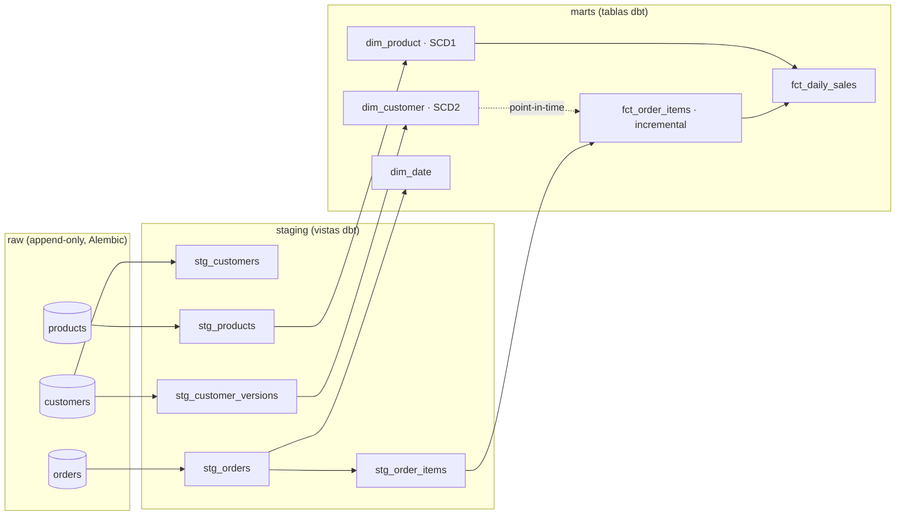

# Modelo de datos (fase 5)



## Granularidad de cada tabla

| Tabla | Granularidad (una fila por…) | Clave | Notas |
|-------|------------------------------|-------|-------|
| `raw.customers` | versión recibida de un cliente | `_raw_id`; único `_record_hash` | Todas las versiones; nunca se actualiza |
| `raw.orders` | versión recibida de un pedido | `_raw_id`; único `_record_hash` | Líneas en `items` (jsonb) |
| `raw.products` | versión recibida de un producto | `_raw_id`; único `_record_hash` | |
| `staging.stg_customers` | cliente (versión vigente) | `customer_id` | Correo → `email_sha256` |
| `staging.stg_customer_versions` | (cliente, `updated_at`) | ambos | Base del SCD2 |
| `staging.stg_orders` | pedido (versión vigente) | `order_id` | `versions_received` cuenta versiones |
| `staging.stg_order_items` | línea de pedido vigente | (`order_id`, `line_no`) | Aplana `items` |
| `staging.stg_products` | producto (versión vigente) | `product_id` | |
| `marts.dim_customer` | versión de cliente | `customer_sk` | SCD2: `valid_from`/`valid_to`/`is_current` |
| `marts.dim_product` | producto | `product_id` | SCD1 (estado actual) |
| `marts.dim_date` | día | `date_day` | Rango de pedidos ± 30 días |
| `marts.fct_order_items` | línea de pedido | (`order_id`, `line_no`) | Incremental; `customer_sk` *point-in-time* |
| `marts.fct_daily_sales` | (día, categoría) | ambos | Solo ventas efectivas en `revenue`/`units` |

## Decisiones (ADR-0008)

- **SCD2 construido desde la historia de `raw`, no con `dbt snapshot`.** Un snapshot solo ve el
  estado en el momento en que corre: si se pierde una ejecución, se pierde historia, y no se
  puede reconstruir. Como `raw` guarda todas las versiones, `dim_customer` se recalcula entera
  y de forma determinista con `lead()` sobre `updated_at`.
- **La primera versión de cada cliente es válida desde 1900-01-01.** Un pedido anterior a la
  primera exportación del cliente (mismo día, hora anterior) encuentra igualmente su versión.
- **`fct_order_items` es incremental con `delete+insert` por `order_id`.** Cuando llega una
  versión nueva de un pedido se borran todas sus líneas y se insertan las nuevas. Si la nueva
  versión trae menos líneas, no quedan líneas fantasma.
- **Prueba de equivalencia:** `test_incremental_day_by_day_equals_full_refresh` carga los 3 días
  ejecutando dbt tras cada uno y compara el resultado, fila a fila, con un `--full-refresh`.

## Pruebas de dbt (39)

| Tipo | Ejemplos |
|------|----------|
| Genéricas | `unique`, `not_null`, `accepted_values` (estados), `unique_combination` (macro propia, sin paquetes externos) |
| Relaciones | `fct_order_items` → `dim_date` (error), → `dim_customer` / `dim_product` (**aviso**) |
| Singulares | Conciliación de ingresos (hechos = agregado diario), conciliación de volumen (staging = hechos), intervalos SCD2 sin huecos ni solapes, última versión de cada pedido, importes no negativos |

### Por qué las relaciones son un aviso y no un error

Un pedido puede referirse a un cliente o producto que **no existe en la dimensión** por dos
motivos, y los dos son información útil:

1. El dato llegó así de la fuente (`C99999`, producto `9999`, inyectados a propósito).
2. **La cuarentena se propaga como orfandad.** Si un cliente se rechazó por tener un correo
   vacío y nunca volvió a llegar limpio, sus pedidos (válidos) quedan sin dimensión.

Detener todo el modelo por esto ocultaría el resto de los indicadores; un aviso lo deja visible
en el dashboard. `test_orphan_warnings_match_lines_without_a_dimension` verifica que el número
de avisos coincide exactamente con las líneas sin dimensión.

### Resultados en `ops.quality_results`

Cada prueba de dbt se guarda con `layer = 'post_transform'`. dbt informa cuántas filas violan la
regla, pero no cuántas se evaluaron; por eso, en esta capa, `rows_evaluated = rows_failed` y
`details.rows_evaluated_unknown = true`.

## Trazabilidad de un indicador

```
fct_daily_sales (día, categoría)
  → fct_order_items (order_id, line_no, _batch_id)
    → ops.ingestion_registry (batch_id → archivo orders_batch_00N.json + sha256)
      → ops.pipeline_runs (run_id → flujo, cuándo, quién lo disparó, resultado)
```

## Minimización de datos

El correo en claro solo existe en `raw` (que la API no puede leer). Staging y marts usan
`email_sha256`; una prueba verifica que ninguna tabla de `marts` tiene una columna `email`.
