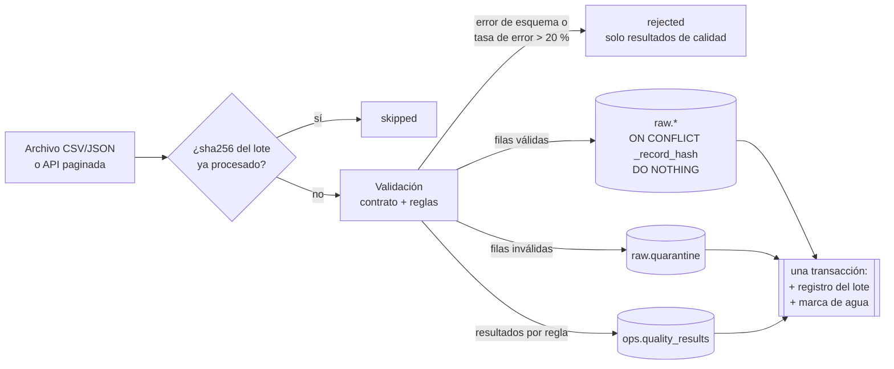

# Pipeline: ingesta (fase 3) y orquestación (fase 4)



## Idempotencia y recuperación

| Situación | Qué pasa | Dónde se garantiza |
|-----------|----------|--------------------|
| Mismo archivo otra vez (aunque cambie el nombre) | `skipped` por sha256 del contenido | `ops.ingestion_registry` único `(source_name, content_sha256)` |
| Registro ya cargado en otro lote | Se ignora | `raw.*._record_hash` único + `ON CONFLICT DO NOTHING` |
| Nueva versión de un registro (`updated_at` posterior) | Se carga como fila nueva; staging elige la última | Hash distinto |
| Falla a mitad de la carga | No queda **nada** escrito; lote `failed`; el reintento reutiliza el `batch_id` | Una transacción por lote |
| La carga falla | La marca de agua **no** avanza | Se actualiza en la misma transacción |
| Dos ejecuciones simultáneas de la misma fuente | La segunda falla con `ConcurrentIngestionError` | `pg_try_advisory_xact_lock` |
| API: fallo transitorio (red, 429, 5xx) | Reintento con `Retry-After` o backoff exponencial con *jitter* | `ingestion/rest.py` |
| API: 4xx o contrato roto | Falla inmediata, sin reintentos inútiles | `ingestion/rest.py` |

## Carga incremental de la API

DummyJSON no filtra por fecha, así que se lee el catálogo y se filtra en el cliente:
`updatedAt > marca_de_agua − solapamiento` (60 min por defecto). El solapamiento recoge
cambios tardíos; lo ya cargado se descarta por hash. El lote se identifica por el hash del
conjunto de registros seleccionados: si no cambió nada, el lote se omite.

## Reglas de calidad (catálogo)

| Fuente | Reglas |
|--------|--------|
| Clientes | `not_null:{customer_id,email,updated_at}`, `format:{customer_id,email,country}`, `type:{signup_date,updated_at}`, `accepted_values:segment` |
| Pedidos | `not_null:{order_id,customer_id,order_ts,updated_at,status}`, `format:{order_id,customer_id,currency}`, `type:{order_ts,updated_at,items,items.*}`, `not_empty:items`, `range:items.{quantity,product_id,unit_price}`, `accepted_values:status` |
| Productos | `not_null:{id,title,category,price,updatedAt}`, `type:*` numéricos y fechas, `range:{price,discountPercentage,rating,stock,id}` |
| Todas | `duplicate_in_batch` (aviso), `schema_change:*` (aviso o rechazo), `error_budget` |

## Ejecutar

```powershell
# Con PostgreSQL y la API simulada levantados (docker compose up -d postgres migrate mock-source)
uv run python -m datapulse.ingestion customers data/samples/customers/*.csv
uv run python -m datapulse.ingestion orders data/samples/orders/*.json
uv run python -m datapulse.ingestion products            # o --base-url https://dummyjson.com
```

Cada comando imprime un resumen JSON por lote y deja la traza en `ops.pipeline_runs`,
`ops.task_runs`, `ops.ingestion_registry` y `ops.quality_results`.

## Orquestación con Prefect (fase 4)

| Flujo | Qué hace | Programación (worker) |
|-------|----------|-----------------------|
| `ingest-files` | Archivos de `data/landing/<fuente>/`, en orden de nombre | — (lo llama `daily-pipeline`) |
| `ingest-products` | Carga incremental de la API | Cada 60 min (`products-incremental`) |
| `daily-pipeline` | Clientes → pedidos → productos → transformación | `0 6 * * *` UTC (`daily`) |

**Reintentos en dos niveles:**

| Nivel | Ante qué | Cómo |
|-------|----------|------|
| Petición HTTP (`ingestion/rest.py`) | Red, 429, 5xx | `Retry-After` o backoff exponencial con jitter, hasta `DATAPULSE_INGEST_MAX_RETRIES` |
| Tarea de Prefect | La fuente sigue caída tras los reintentos HTTP, BD no disponible, bloqueo concurrente | `retries=2`, `retry_delay_seconds=10`, solo si `is_transient()` |
| — | Contrato roto, `ValueError`, archivo inexistente | **No se reintenta**: falla al instante y se ve en el dashboard |

Cada intento de tarea queda en `ops.task_runs` con su número de intento. Cada flujo queda en
`ops.pipeline_runs` enlazado con el `flow_run.id` de Prefect (`orchestrator_run_id`).

**Aislamiento de fallos:** si la API de productos cae, `daily-pipeline` carga igual clientes y
pedidos y termina en fallo al final. Una re-ejecución recupera lo pendiente sin duplicar nada.

```powershell
uv run python -m datapulse.flows seed-landing      # copia los ejemplos a data/landing
uv run python -m datapulse.flows run daily         # ejecuta ahora (Prefect efímero si no hay servidor)
docker compose up -d                               # servidor de Prefect en http://localhost:4200 + worker
```
